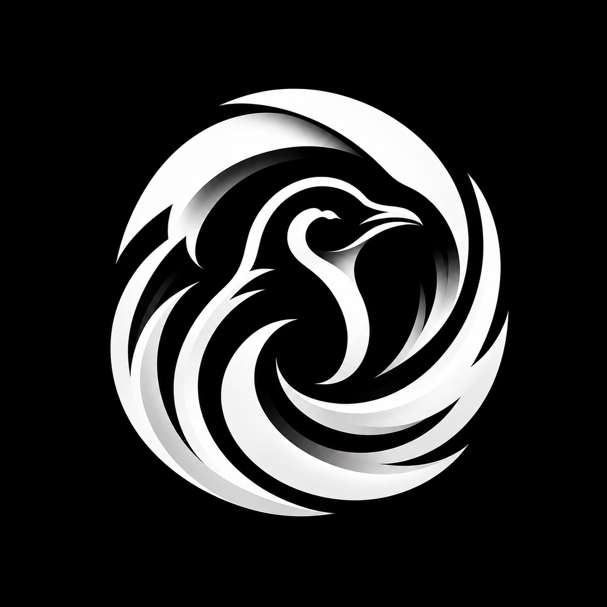
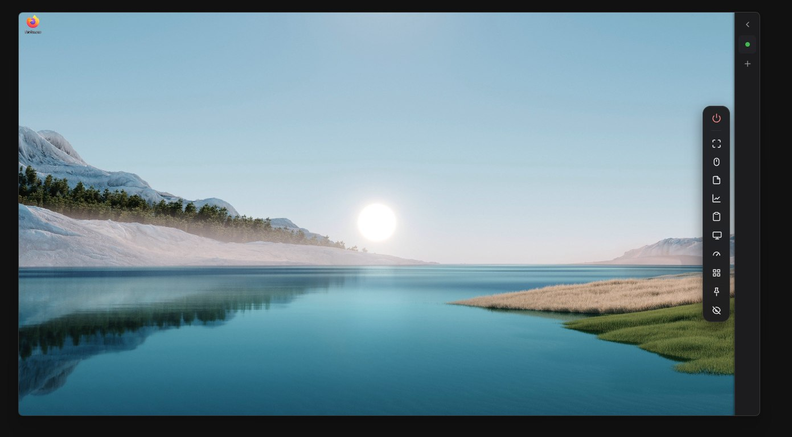
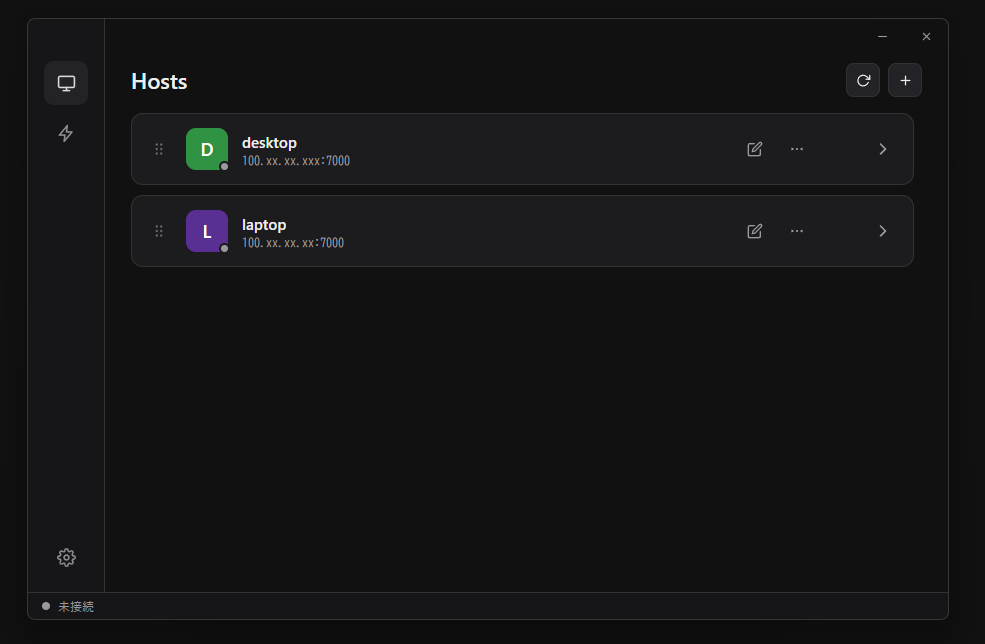
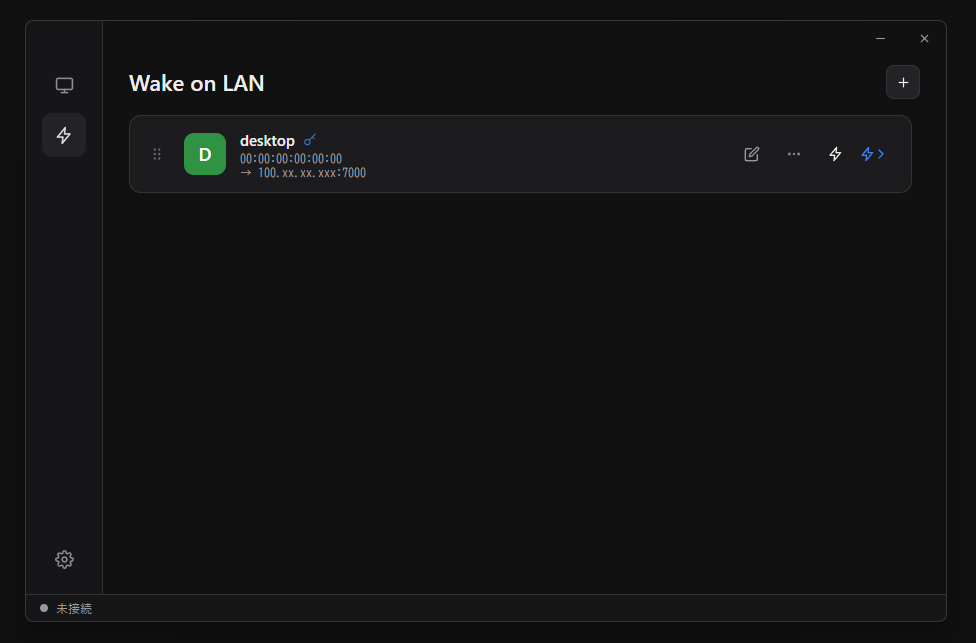

<div align="center">
  

  # Aurora

  
  
  
  
  
  

  [](https://github.com/pnc-t/Aurora/actions/workflows/ci.yml)
  [](https://github.com/pnc-t/Aurora/releases/latest)
</div>

出先の PC から自宅 PC に接続して操作する、自作の軽量リモートデスクトップアプリ。
RDP / VNC / RustDesk 等を使わず、Rust でゼロから実装しています。設計目標は **「軽く・早く・快適」**。

> ⚠️ 個人プロジェクトです。**ネットワークは [Tailscale](https://tailscale.com/) (Tailnet) 直結を前提**にしており、NAT 越え・シグナリング・中継サーバは実装していません。独立した第三者によるセキュリティ監査は受けていません。自己責任で利用してください。

<p align="center">
  
</p>

<p align="center">
  
  
</p>

<p align="center">
  <sub>接続中のリモート画面 (右端がツールバー) ／ ホスト一覧から接続 ／ Wake-on-LAN で自宅 PC を起こしてそのまま接続</sub>
</p>

---

## できること

| 分類 | 機能 |
|------|------|
| **映像・音声** | H.264 / HEVC / AV1 のコーデックネゴシエーション<br>GPU ハードウェアエンコード + WebCodecs GPU デコード<br>Opus 音声 / 画質プリセット<br>解像度追従 (RDP 風) と仮想ディスプレイ |
| **入力** | マウス / キー入力注入<br>IME 日本語入力<br>キーボード占有 (Win キーや Alt+Tab をホストへ送る) |
| **ファイル・クリップボード** | クリップボード同期<br>ファイル転送<br>ProjFS によるドライブ投影 |
| **運用** | Windows サービスとして常駐 (UAC の確認画面・ロック画面・サインイン画面も遠隔操作できる)<br>マルチタブ接続 / クライアント設定ページ<br>ネットワーク切替時のシームレス再接続<br>Wake-on-LAN によるリモート起動<br>自動アップデート (新版を通知しワンクリックで更新) |

---

## はじめかた

1. **操作される PC (ホスト)**: [Releases](https://github.com/pnc-t/Aurora/releases/latest) から `aurora-host-setup-<ver>.exe` を実行してインストールし、初回に出るダイアログ (またはタスクトレイのアイコン) から接続パスワードを設定します。ホストは Windows サービスとして PC 起動時から常駐します
2. **両方の PC**: [Tailscale](https://tailscale.com/) をインストールし、同じ Tailnet に参加させます (`tailscale ip -4` でホストの `100.x.x.x` を控えておきます)
3. **操作する PC (クライアント)**: `Aurora_<ver>_x64-setup.exe` を実行してインストールし、ランチャーの ＋ からホストの `100.x.x.x` / ポート (既定 7000) / パスワードを登録して接続します

自宅 PC を無人で起動しておく構成 (自動起動 + WoL) は [docs/remote-access-setup.md](docs/remote-access-setup.md)、スマホ (Android) から使いたい場合は [docs/mobile.md](docs/mobile.md)、うまく繋がらないときは [docs/troubleshooting.md](docs/troubleshooting.md) を参照してください。

---

## ダウンロード

[](https://github.com/pnc-t/Aurora/releases/latest)

ビルド済みバイナリは [Releases](https://github.com/pnc-t/Aurora/releases/latest) から入手できます。

| 成果物 | 用途 |
|--------|------|
| `Aurora_<ver>_x64-setup.exe` | クライアント (操作する側) の NSIS インストーラ |
| `aurora-host-setup-<ver>.exe` | ホスト (操作される側) の NSIS インストーラ |
| `aurora-wol-<ver>-aarch64` | Wake-on-LAN リレー (Raspberry Pi / aarch64 Linux 向けバイナリ) |
| `Aurora_<ver>.apk` | Android クライアント (7.0 以上。[docs/mobile.md](docs/mobile.md)) |

`main` に `v*` タグを push すると GitHub Actions が上記を自動ビルドして Release に添付します。
ソースからビルドする場合は [docs/build.md](docs/build.md) を参照してください。

> ⚠️ 配布インストーラ自体は Authenticode コード署名がされておらず、SmartScreen / Defender に
> 警告される場合があります (詳細は [docs/security.md](docs/security.md))。一方、host/client の
> 自動アップデートでダウンロードされる更新物は minisign 署名を検証してから適用するため、
> この 2 つは別の話です。

---

## 設計の要点

- **低遅延の映像パイプライン**: DXGI Desktop Duplication → Media Foundation を GPU 上で完結させ、CPU コピーを避けます
- **役割分離プロトコル**: 制御は TCP、映像/音声は UDP に分離し、遅延予算を確保します
- **エンドツーエンド暗号化**: Noise XX-PSK ハンドシェイク。PSK は接続パスワードから Argon2id で導出します
- **Tailscale 直結前提**: NAT 越え・シグナリング・中継サーバは実装しません (スコープを絞るための意図的な設計)。ホストは既定で Tailscale インターフェースのみに bind し、LAN / インターネットへ露出しません

### 技術スタック

| 領域 | 採用 |
|------|------|
| 言語 / ランタイム | Rust 2024 edition / `tokio` |
| クライアント GUI | Tauri v2 + Vanilla TypeScript + Vite (フレームワーク非採用) |
| 画面キャプチャ | DXGI Desktop Duplication (Windows) |
| 映像コーデック | H.264 / HEVC / AV1 ハードウェアエンコード (ネゴシエーションで自動選択) / デコードは WebCodecs `VideoDecoder` (GPU) |
| 音声 | `cpal` (loopback) + Opus (20ms frame) |
| 暗号化 | `snow` (Noise XX-PSK) + `argon2` (PSK 導出) |

詳細は [docs/architecture.md](docs/architecture.md) (クレート構成・パイプライン)、[docs/protocol.md](docs/protocol.md) (ワイヤフォーマット)、[docs/security.md](docs/security.md) (脅威モデル・既知の制約) を参照してください。

---

## 開発者向け

<details>
<summary>ビルド環境・ビルドコマンド</summary>

### 必要環境

- **Rust** (2024 edition 対応のツールチェイン)
- **Node.js + pnpm** (クライアントのフロントエンドビルド)
- **Tauri v2 CLI** (`cargo install tauri-cli` など)

### ビルド

```powershell
# 全クレートビルド (リリース)
cargo build --workspace --release

# ホスト起動 (debug)。リリース計測時は --release
cargo run -p aurora-host

# クライアント (crates/client/src-tauri から実行する)
cargo tauri dev          # 開発モード (Tauri ウィンドウ + Vite dev サーバ)
cargo tauri build        # 本番ビルド
```

ホストの CLI オプション一覧 (ポート/bind アドレス/パスワード設定/GPU 指定など) は [docs/build.md](docs/build.md) を参照してください。

</details>

---

## 対応プラットフォーム

| | Windows | macOS | Linux |
|--|---------|-------|-------|
| ホスト | ✅ 主対象 (キャプチャ/エンコード/入力/音声/ファイル) | 🚧 移植途上 | 🚧 移植途上 |
| クライアント | ✅ | (Tauri 依存) | (Tauri 依存) |

クライアントは Android (7.0 以上) にも対応しています。iOS は未対応です。

Windows を優先して完成させ、Mac/Linux は OS ポート (`cfg` 分岐の追加) でまとめて対応する方針です。

### 既知の制約

- **HDR ディスプレイのキャプチャ**: 現状 SDR 前提のトーンマップで取り込むため、HDR 有効なディスプレイでは映像が眩しく (白飛び気味に) なります。さらに 1440p 以上の高解像度 + HDR の組み合わせでは、ハードウェアエンコーダがビットレート上限を尊重せずフレームレートが落ちる制約もあります。快適に使うにはディスプレイの HDR をオフにした SDR 運用を推奨します

---

## ライセンス

以下のいずれかを選択して利用できます。

- Apache License 2.0 ([LICENSE-APACHE](LICENSE-APACHE))
- MIT License ([LICENSE-MIT](LICENSE-MIT))

`SPDX-License-Identifier: MIT OR Apache-2.0`

### 同梱しているサードパーティソフトウェア

ホストのインストーラは以下を同梱して再配布しています (ライセンス本文は
[installer/host/THIRD-PARTY-NOTICES.txt](installer/host/THIRD-PARTY-NOTICES.txt)、インストール先にも同じファイルを置きます)。

| ソフトウェア | 用途 | ライセンス |
|---|---|---|
| [Virtual Display Driver](https://github.com/VirtualDrivers/Virtual-Display-Driver) (MttVDD) | 仮想ディスプレイ | MIT |
| [nefcon](https://github.com/nefarius/nefcon) (nefconw.exe) | 仮想ディスプレイのデバイス登録 | MIT |

アイコン画像は ChatGPT (OpenAI) で生成したものです。
